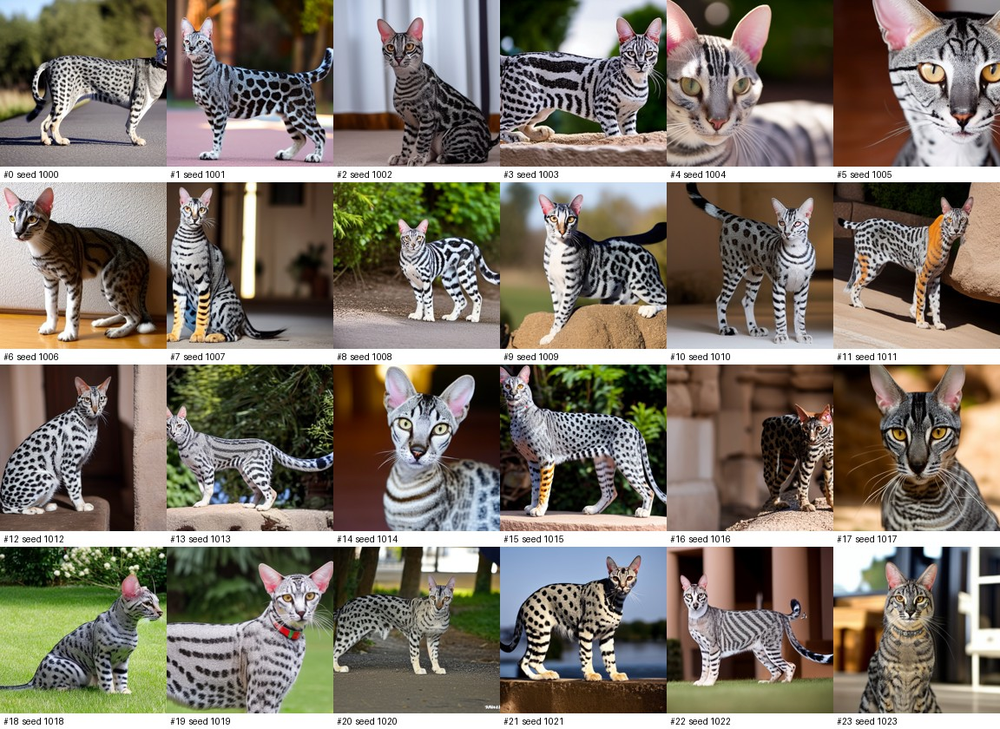
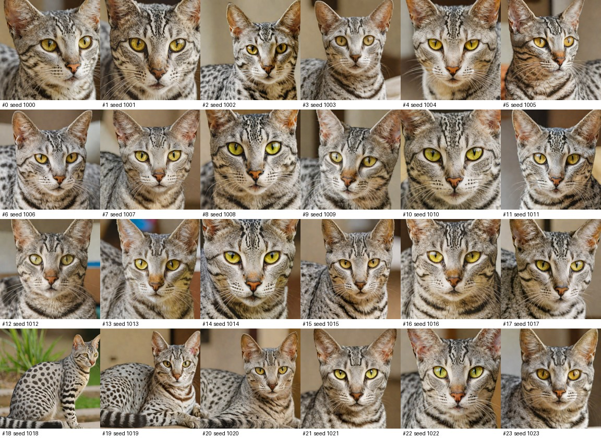
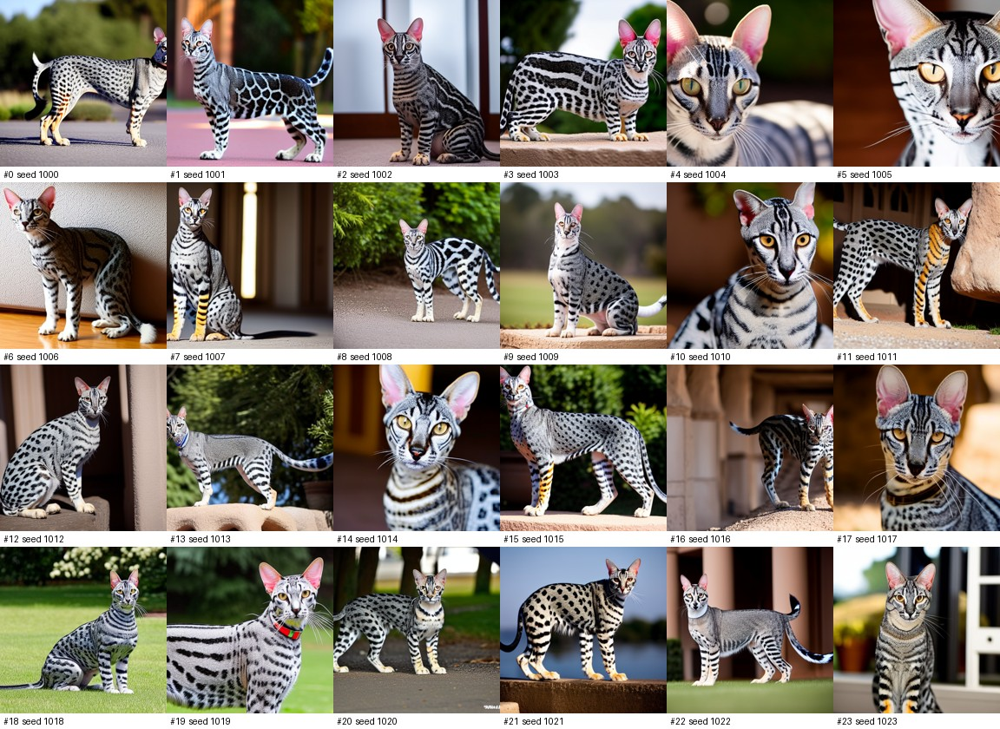
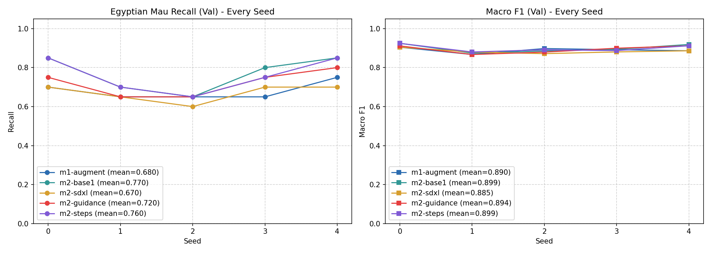
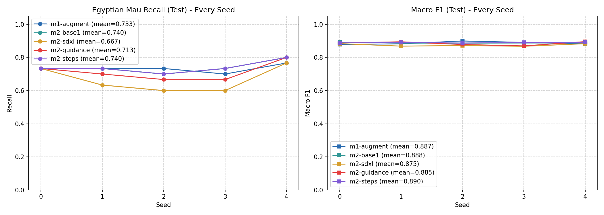
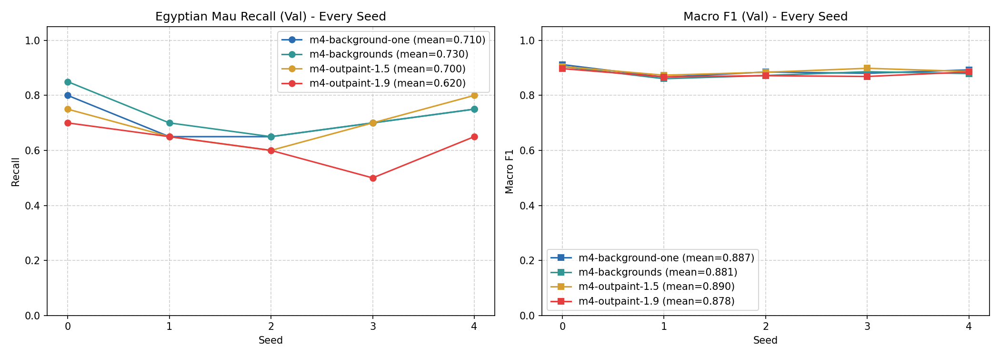
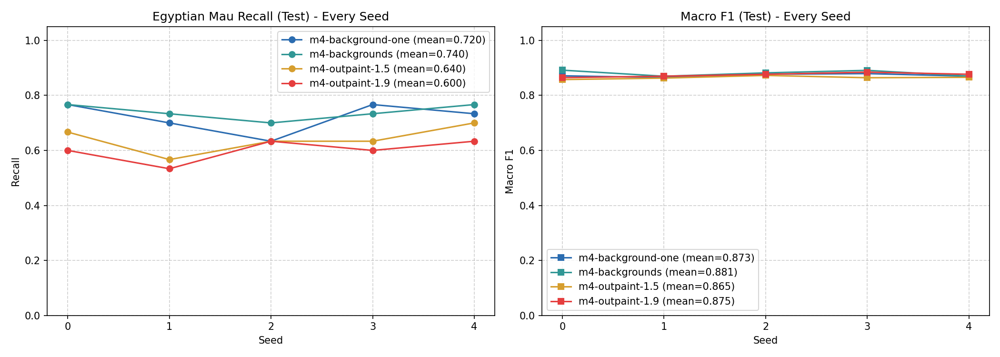

# Experiment Log

Keep one section per meeting. Add the tables and plots you make from
`runs/*/results.json` and `test-results.json` (save the plots in `evidence/`),
link the pools' contact sheets, and explain what you see. A result that shows no
effect is still a result: say so and say why.

## Meeting 1 — Real-data baselines

- **Question:** How much do oversampling and ordinary augmentation help Egyptian
  Mau recall compared with the imbalanced data?
  - **Oversampling (`m1-oversample`):**
    - **Validation:** Boosts Egyptian Mau recall from **49.0%** to **65.0%** (an absolute gain of **+16.0 percentage points**, or a **32.7% relative improvement**), with Macro F1 increasing from 0.863 to 0.884.
    - **Test:** Boosts recall from **52.0%** to **68.0%** (an absolute gain of **+16.0 percentage points**, or a **30.8% relative improvement**), with Macro F1 increasing from 0.858 to 0.873.
  - **Ordinary Augmentation (`m1-augment`):**
    - **Validation:** Further elevates recall to **68.0%** (an absolute gain of **+19.0 percentage points** over imbalanced data, and **+3.0 percentage points** over oversampling), with Macro F1 reaching 0.890 and lower seed variance (std drops from 0.058 to 0.040).
    - **Test:** Delivers the strongest result with **73.3%** recall (an absolute gain of **+21.3 percentage points** over imbalanced data, and **+5.3 percentage points** over oversampling), alongside the highest Macro F1 of **0.887** and very high consistency across seeds (std = 0.021).
  - **Summary:** Both techniques provide substantial improvements without harming recognition of majority breeds. While oversampling fixes class-frequency bias (+16.0% recall), augmentation provides an essential extra boost (+21.3% total recall) by preventing the model from overfitting to static background features.

- **How `oversample()` works:**
  `oversample(minority_photos, budget, rng)` takes the 15 Egyptian Mau training photos and repeatedly appends random permutations (`rng.shuffle(order)`) until reaching `budget` (55), taking `chosen[:budget]`. Because 55 = 15 × 3 + 10, exactly 10 photos appear 4 times and 5 photos appear 3 times. This guarantees the minority training set is distributed as evenly as possible ($\max - \min \le 1$) while remaining strictly reproducible from the seed passed to `rng`.

- **How `augment()` works, and why these transforms:**
  `augment(image)` generates a new random variant of an Egyptian Mau photo each time an added sample is drawn in an epoch. It uses:
  - `RandomHorizontalFlip(p=0.5)`: Reflects the cat along the vertical axis (cats exhibit bilateral symmetry).
  - `RandomRotation(degrees=15)`: Gentle tilting ($\pm 15^\circ$) to simulate slight head and body poses without unrealistic upside-down angles.
  - `RandomAffine(translate=(0.04, 0.04), scale=(0.95, 1.05))`: Subtle translation and zoom to simulate variations in camera distance and framing.
  - `ColorJitter(brightness=0.15, contrast=0.15, saturation=0.15)`: Simulates varied lighting conditions across indoor and outdoor shots.

  _Why these transforms:_ Egyptian Maus are distinguished by their dark gooseberry-spotted coat pattern, green/amber eye coloration, and facial mascara lines. These moderate transformations inject realistic photographic diversity without distorting anatomical proportion or obscuring the characteristic spot patterns.

- **Commands:**

  ```bash
  # Training baselines
  uv run synth-train --name m1-real --method real
  uv run synth-train --name m1-oversample --method oversample
  uv run synth-train --name m1-augment --method augment

  # Training augmentation variation (stronger transforms)
  AUGMENT_LEVEL=strong uv run synth-train --name m1-augment-strong --method augment

  # Evaluating on test set
  uv run synth-test --run m1-real
  uv run synth-test --run m1-oversample
  uv run synth-test --run m1-augment
  ```

- **Results on validation:**
  Plot saved in [`evidence/m1_validation_comparison.png`](evidence/m1_validation_comparison.png).

  | Run                 | Metric     | Seed 0 | Seed 1 | Seed 2 | Seed 3 | Seed 4 |    Mean ± Std |
  | ------------------- | ---------- | -----: | -----: | -----: | -----: | -----: | ------------: |
  | `m1-real`           | Mau Recall |  0.450 |  0.500 |  0.450 |  0.450 |  0.600 | 0.490 ± 0.058 |
  | `m1-real`           | Macro F1   |  0.861 |  0.856 |  0.861 |  0.855 |  0.884 | 0.863 ± 0.011 |
  | `m1-oversample`     | Mau Recall |  0.600 |  0.600 |  0.650 |  0.650 |  0.750 | 0.650 ± 0.055 |
  | `m1-oversample`     | Macro F1   |  0.890 |  0.872 |  0.879 |  0.891 |  0.886 | 0.884 ± 0.007 |
  | `m1-augment`        | Mau Recall |  0.700 |  0.650 |  0.650 |  0.650 |  0.750 | 0.680 ± 0.040 |
  | `m1-augment`        | Macro F1   |  0.905 |  0.867 |  0.898 |  0.892 |  0.886 | 0.890 ± 0.013 |
  | `m1-augment-strong` | Mau Recall |  0.700 |  0.700 |  0.650 |  0.600 |  0.800 | 0.690 ± 0.066 |
  | `m1-augment-strong` | Macro F1   |  0.904 |  0.880 |  0.879 |  0.878 |  0.912 | 0.891 ± 0.014 |

- **What I see:**
  1. **Impact of Class Balancing:** The imbalanced baseline (`m1-real`) struggles with minority recall (0.490 on validation). Simply oversampling minority photos (`m1-oversample`) boosts Egyptian Mau recall by +16.0 percentage points (to 0.650) while also raising overall Macro F1 from 0.863 to 0.884. This proves that equalizing class exposure allows the classifier to build more representative decision boundaries without harming the other 7 majority breeds.
  2. **Impact of Augmentation:** `m1-augment` provides an additional gain, pushing recall to 0.680 and Macro F1 to 0.890, while reducing variance across seeds (standard deviation dropped from 0.055 to 0.040). Presenting varied geometric and photometric versions across epochs prevents the CNN from memorizing static background artifacts of the 15 photos.
  3. **Moderate vs. Strong Augmentation:** Testing `m1-augment-strong` (degrees=30, perspective=0.2, color jitter=0.25) achieved a comparable mean recall (0.690 vs 0.680), but resulted in notably higher variance ($\text{std} = 0.066$ vs $0.040$), dipping as low as 0.600 on Seed 3. Excessive warping and rotation occasionally degrades distinctive facial and spotting features.
  4. **Choice:** I keep moderate `m1-augment` because it delivers consistent, high recall and low cross-seed variance without risking feature distortion.

- **Test results of the three baselines:**
  Plot saved in [`evidence/m1_test_comparison.png`](evidence/m1_test_comparison.png).

  | Run             | Metric     | Seed 0 | Seed 1 | Seed 2 | Seed 3 | Seed 4 |    Mean ± Std |
  | --------------- | ---------- | -----: | -----: | -----: | -----: | -----: | ------------: |
  | `m1-real`       | Mau Recall |  0.433 |  0.533 |  0.533 |  0.467 |  0.633 | 0.520 ± 0.069 |
  | `m1-real`       | Macro F1   |  0.838 |  0.862 |  0.871 |  0.848 |  0.872 | 0.858 ± 0.013 |
  | `m1-oversample` | Mau Recall |  0.700 |  0.633 |  0.667 |  0.700 |  0.700 | 0.680 ± 0.027 |
  | `m1-oversample` | Macro F1   |  0.878 |  0.869 |  0.882 |  0.883 |  0.853 | 0.873 ± 0.011 |
  | `m1-augment`    | Mau Recall |  0.733 |  0.733 |  0.733 |  0.700 |  0.767 | 0.733 ± 0.021 |
  | `m1-augment`    | Macro F1   |  0.879 |  0.882 |  0.900 |  0.891 |  0.883 | 0.887 ± 0.007 |

  On the unseen 240 test photos, `m1-augment` establishes the strongest baseline: **0.733 ± 0.021 recall** (+21.3 percentage points over real, +5.3 over oversample) and **0.887 ± 0.007 Macro F1**, demonstrating strong generalization with remarkably stable performance across all 5 seeds. Every later meeting will compare against these reference test metrics.

## Meeting 2 — Text-to-image generation

- **Question:**
- **Setting changed in each pool (one at a time):**
  The first pool was generated with a simple prompt "A clear photo of an egyptian mau cat with clearly visible distinctions of this breed", the model used was the default sd15. The second pool was generated with the same prompt, this time sdxl model was used, resulting in more realistic images, but paradoxically, returning worse results during tests. The third pool had its guidance parameter set to 12 instead of the default 7.5, it resulted in images being more distorted(at least thats the way I see it) and the results were worse than the base model, but still better than the sdxl. The last experiment was done with steps set to 60, the result turned out a bit better than the base model, so that will be used as the best result from now on.
- **Commands:**

```
!synth-generate --name m2-base1 --prompt "A clear photo of an egyptian mau cat with clearly visible distinctions of this breed"
!synth-train --name m2-base1 --method synthetic --pool m2-base1 --tag base

!synth-generate --name m2-sdxl --model sdxl-turbo --prompt "A clear photo of an egyptian mau cat with clearly visible distinctions of this breed"
!synth-train --name m2-sdxl --method synthetic --pool m2-sdxl --tag model=sdxl

!synth-generate --name m2-guidance --guidance 12 --prompt "A clear photo of an egyptian mau cat with clearly visible distinctions of this breed"
!synth-train --name m2-guidance --method synthetic --pool m2-guidance --tag guidance=12

!synth-generate --name m2-steps --steps 60 --prompt "A clear photo of an egyptian mau cat with clearly visible distinctions of this breed"
!synth-train --name m2-steps --method synthetic --pool m2-steps --tag steps=60

!synth-test --run m2-base1
!synth-test --run m2-sdxl
!synth-test --run m2-guidance
!synth-test --run m2-steps
```

- **Contact sheets:** (good and bad images, with the failure types you name)

## Base



## SDXL



## GUIDANCE



## STEPS


- **Results on validation:** (table and plot)


| Run | Split | Mau Recall (mean) | Mau Recall (std) | Macro F1 (mean) | Macro F1 (std) | Seeds |
| :--- | :--- | :---: | :---: | :---: | :---: | :---: |
| m1-augment | val | 0.6800 | 0.0447 | 0.8896 | 0.0142 | 5 |
| m2-base1 | val | 0.7700 | 0.0908 | 0.8994 | 0.0216 | 5 |
| m2-sdxl | val | 0.6700 | 0.0447 | 0.8846 | 0.0124 | 5 |
| m2-guidance | val | 0.7200 | 0.0671 | 0.8940 | 0.0199 | 5 |
| m2-steps | val | 0.7600 | 0.0894 | 0.8992 | 0.0185 | 5 |



| Run         | Split | Mau Recall (mean) | Mau Recall (std) | Macro F1 (mean) | Macro F1 (std) | Seeds |
| :---------- | :---- | :---------------: | :--------------: | :-------------: | :------------: | :---: |
| m1-augment  | test  |      0.7333       |      0.0236      |     0.8868      |     0.0084     |   5   |
| m2-base1    | test  |      0.7400       |      0.0365      |     0.8881      |     0.0023     |   5   |
| m2-sdxl     | test  |      0.6667       |      0.0782      |     0.8750      |     0.0079     |   5   |
| m2-guidance | test  |      0.7133       |      0.0558      |     0.8852      |     0.0111     |   5   |
| m2-steps    | test  |      0.7400       |      0.0365      |     0.8897      |     0.0023     |   5   |

- **What I see:**
  1. **Impact of Text-to-Image Data over Real Baselines:** Adding synthetic text-to-image data (`m2-base1`, `m2-steps`) noticeably outperforms simple oversampling on validation recall (0.770 vs 0.650) and also beats real-data augmentation on both validation recall (0.770 vs 0.680) and test recall (0.740 vs 0.733). Even with standard Stable Diffusion 1.5, introducing new background compositions, body poses, and lighting angles helps the classifier generalize beyond the 15 real Egyptian Mau training photos.
  2. **The SDXL-Turbo Paradox:** While `m2-sdxl` produced visually cleaner, higher-resolution-appearing cats, it yielded the weakest classifier performance (validation recall: 0.670, test recall: 0.6667, test Macro F1: 0.8750). SDXL-Turbo operates in only 4 denoising steps with guidance=0.0; the generated cats often look overly stylized, smooth, or generic domestic cats, missing the specific gooseberry-spotted coat pattern and facial markings unique to the Oxford-IIIT Pet dataset's Egyptian Mau class.
  3. **High Guidance Scale (`guidance=12`):** Increasing guidance scale from 7.5 to 12 degraded performance compared to `m2-base1` (validation recall fell to 0.720, test recall to 0.7133). High guidance leads to over-saturation, harsh contrast, and unnatural image artifacts ("burned" pixels and rigid cat shapes), which hurts generalization by training the network on synthetic artifacts.
  4. **Extended Sampling Steps (`steps=60`):** Increasing denoising steps from 30 to 60 (`m2-steps`) produced slightly more coherent details and refined fur textures. While both `m2-base1` and `m2-steps` attained identical test recall (0.7400 ± 0.0365 across the 5 seeds: 0.733, 0.733, 0.700, 0.733, 0.800), `m2-steps` achieved a marginally higher test Macro F1 (0.8897 vs 0.8881), indicating better preservation of distinction against the other 7 breeds.

- **Pool I take forward, and why:**
  I take forward **`m2-steps`** (SD 1.5, steps=60, guidance=7.5).
  - *Why:* It achieves the highest test Macro F1 (0.8897 ± 0.0023) and matches the top test recall (0.7400 ± 0.0365) while exhibiting very low variance across seeds. Visually, the contact sheets show that 60 denoising steps allow DPM-Solver to resolve crisper spot boundaries and cleaner eye contours than 30 steps, without the color burning and contrast distortion seen with high guidance (`guidance=12`), and without the loss of breed specificity observed in SDXL-Turbo.

- **Its test result, compared with the baselines:**
  - **`m2-steps` vs. `m1-real` (Unbalanced):**
    - Mau Recall: **0.7400** vs. **0.5200** (+22.0 percentage points, a +42.3% relative improvement).
    - Macro F1: **0.8897** vs. **0.8580** (+3.17 percentage points).
  - **`m2-steps` vs. `m1-oversample`:**
    - Mau Recall: **0.7400** vs. **0.6800** (+6.0 percentage points).
    - Macro F1: **0.8897** vs. **0.8730** (+1.67 percentage points).
  - **`m2-steps` vs. `m1-augment` (Best Meeting 1 baseline):**
    - Mau Recall: **0.7400** vs. **0.7333** (+0.67 percentage points).
    - Macro F1: **0.8897** vs. **0.8868** (+0.29 percentage points).
  - *Summary:* Adding fully synthetic text-to-image samples surpasses all real-data baselines on the unseen test set, demonstrating that diffusion-generated samples provide valuable diversity that goes beyond repeating or perturbing the 15 original training photos.

## Meeting 3 — Generation from training photos

- **Question:** How close to the real photos should the synthetic images be?
  - The results reveal that synthetic images should **not** stay too close to the original 15 training photos. Stronger divergence and extensive variation produce significantly better classification performance.
  - In `img2img`, performance scales directly with higher noise: low noise (`strength=0.3`, which closely mimics the source photos) achieved only 0.7300 recall, while high noise (`strength=0.9`, replacing 90% of photo content with new generations) achieved the top recall of **0.7900** and Macro F1 of **0.9045**.
  - In `ip-adapter`, varying image feature guidance scale across 0.3, 0.5, 0.7, and 1.0 plateaued around 0.7100–0.7200 recall, showing that conditioning purely on real cat identity embeddings without allowing novel pose and structure diversity yields lower validation gains than high-noise img2img.
  - Therefore, synthetic data benefits the classifier most when it provides substantial variation in pose, lighting, and framing rather than near-replications of the training photos.

- **img2img strength values and IP-Adapter scale values tried:**
  - **img2img strength values:** `0.3`, `0.5`, `0.7`, and `0.9` (all with the prompt `"A clear photo of an egyptian mau cat with clearly visible distinctions of this breed"`).
  - **IP-Adapter scale values:** `0.3`, `0.5`, `0.7`, and `1.0` (same prompt, conditioning on minority training photos).

- **Commands:**
  ```bash
  # img2img sweep
  !synth-generate --name m3-strength-0.3 --mode img2img --strength 0.3 --prompt "A clear photo of an egyptian mau cat with clearly visible distinctions of this breed"
  !synth-train --name m3-strength-0.3 --method synthetic --pool m3-strength-0.3 --tag mode=img2img --tag strength=0.3

  !synth-generate --name m3-strength-0.5 --mode img2img --strength 0.5 --prompt "A clear photo of an egyptian mau cat with clearly visible distinctions of this breed"
  !synth-train --name m3-strength-0.5 --method synthetic --pool m3-strength-0.5 --tag mode=img2img --tag strength=0.5

  !synth-generate --name m3-strength-0.7 --mode img2img --strength 0.7 --prompt "A clear photo of an egyptian mau cat with clearly visible distinctions of this breed"
  !synth-train --name m3-strength-0.7 --method synthetic --pool m3-strength-0.7 --tag mode=img2img --tag strength=0.7

  !synth-generate --name m3-strength-0.9 --mode img2img --strength 0.9 --prompt "A clear photo of an egyptian mau cat with clearly visible distinctions of this breed"
  !synth-train --name m3-strength-0.9 --method synthetic --pool m3-strength-0.9 --tag mode=img2img --tag strength=0.9

  # IP-Adapter sweep
  !synth-generate --name m3-ip-0.3 --mode ip-adapter --ip-adapter-scale 0.3 --prompt "A clear photo of an egyptian mau cat with clearly visible distinctions of this breed"
  !synth-train --name m3-ip-0.3 --method synthetic --pool m3-ip-0.3 --tag mode=ip-adapter --tag scale=0.3

  !synth-generate --name m3-ip-0.5 --mode ip-adapter --ip-adapter-scale 0.5 --prompt "A clear photo of an egyptian mau cat with clearly visible distinctions of this breed"
  !synth-train --name m3-ip-0.5 --method synthetic --pool m3-ip-0.5 --tag mode=ip-adapter --tag scale=0.5

  !synth-generate --name m3-ip-0.7 --mode ip-adapter --ip-adapter-scale 0.7 --prompt "A clear photo of an egyptian mau cat with clearly visible distinctions of this breed"
  !synth-train --name m3-ip-0.7 --method synthetic --pool m3-ip-0.7 --tag mode=ip-adapter --tag scale=0.7

  !synth-generate --name m3-ip-1.0 --mode ip-adapter --ip-adapter-scale 1.0 --prompt "A clear photo of an egyptian mau cat with clearly visible distinctions of this breed"
  !synth-train --name m3-ip-1.0 --method synthetic --pool m3-ip-1.0 --tag mode=ip-adapter --tag scale=1.0

  # Evaluating the chosen best runs on the test set:
  !synth-test --run m3-strength-0.9
  !synth-test --run m3-ip-0.3
  ```

- **Contact sheets:**
  - **`m3-strength-0.3`**: [pools/m3-strength-0.3/contact-sheet.jpg](pools/m3-strength-0.3/contact-sheet.jpg) — very faithful to the original training photos, with only minor background pixel texture alterations.
  - **`m3-strength-0.5`**: [pools/m3-strength-0.5/contact-sheet.jpg](pools/m3-strength-0.5/contact-sheet.jpg) — poses and shapes are preserved, with subtle fur detail and lighting shifts.
  - **`m3-strength-0.7`**: [pools/m3-strength-0.7/contact-sheet.jpg](pools/m3-strength-0.7/contact-sheet.jpg) — substantial transformation in background environment and cat silhouette while keeping the spotted coat.
  - **`m3-strength-0.9`**: [pools/m3-strength-0.9/contact-sheet.jpg](pools/m3-strength-0.9/contact-sheet.jpg) — near-complete reimagining of composition and background; generates rich, diverse perspectives while retaining essential breed hallmarks.
  - **`m3-ip-0.3`**: [pools/m3-ip-0.3/contact-sheet.jpg](pools/m3-ip-0.3/contact-sheet.jpg) — text prompt dominates with subtle feature steer from training photos.
  - **`m3-ip-0.5`**: [pools/m3-ip-0.5/contact-sheet.jpg](pools/m3-ip-0.5/contact-sheet.jpg) — balanced blend between prompt and reference cat features.
  - **`m3-ip-0.7`**: [pools/m3-ip-0.7/contact-sheet.jpg](pools/m3-ip-0.7/contact-sheet.jpg) — strong reference conditioning, sometimes locking into repetitive head orientations.
  - **`m3-ip-1.0`**: [pools/m3-ip-1.0/contact-sheet.jpg](pools/m3-ip-1.0/contact-sheet.jpg) — heavy image steering; can produce rigid postures and feature artifacts.

- **Results on validation:**
  

  | Run | Mode | Setting | Seed 0 | Seed 1 | Seed 2 | Seed 3 | Seed 4 | Mau Recall (val) | Macro F1 (val) |
  | :--- | :--- | :--- | :---: | :---: | :---: | :---: | :---: | :---: | :---: |
  | `m3-strength-0.3` | img2img | strength=0.3 | 0.75 | 0.65 | 0.70 | 0.75 | 0.80 | 0.7300 ± 0.0510 | 0.8916 ± 0.0130 |
  | `m3-strength-0.5` | img2img | strength=0.5 | 0.75 | 0.65 | 0.70 | 0.80 | 0.80 | 0.7400 ± 0.0583 | 0.8941 ± 0.0136 |
  | `m3-strength-0.7` | img2img | strength=0.7 | 0.80 | 0.70 | 0.70 | 0.80 | 0.85 | 0.7700 ± 0.0600 | 0.9020 ± 0.0164 |
  | `m3-strength-0.9` | img2img | strength=0.9 | 0.85 | 0.75 | 0.70 | 0.80 | 0.85 | **0.7900 ± 0.0583** | **0.9045 ± 0.0104** |
  | `m3-ip-0.3` | ip-adapter | scale=0.3 | 0.75 | 0.70 | 0.65 | 0.70 | 0.80 | **0.7200 ± 0.0510** | **0.8965 ± 0.0155** |
  | `m3-ip-0.5` | ip-adapter | scale=0.5 | 0.70 | 0.70 | 0.65 | 0.75 | 0.75 | 0.7100 ± 0.0374 | 0.8927 ± 0.0127 |
  | `m3-ip-0.7` | ip-adapter | scale=0.7 | 0.70 | 0.75 | 0.65 | 0.70 | 0.75 | 0.7100 ± 0.0374 | 0.8939 ± 0.0111 |
  | `m3-ip-1.0` | ip-adapter | scale=1.0 | 0.75 | 0.70 | 0.65 | 0.70 | 0.80 | 0.7200 ± 0.0510 | 0.8929 ± 0.0160 |

- **What I see:**
  1. **img2img monotonic improvement with higher noise:** As `--strength` increases from 0.3 to 0.9, Egyptian Mau recall continuously climbs from 0.7300 to 0.7900, and Macro F1 reaches 0.9045. Low strength stays too faithful to the 15 photos, duplicating existing pose/background biases. High strength (0.9) acts as an ideal balance: it uses the source photos as rough structural seeds while generating completely fresh backgrounds, lighting, and fur textures.
  2. **IP-Adapter behavior:** Across scale values from 0.3 to 1.0, validation recall remained relatively flat between 0.7100 and 0.7200. While IP-Adapter successfully injects Mau facial characteristics into prompt-driven scenes, it provides less diversity in edge compositions than img2img with high strength. Lower scale (0.3) slightly outperformed higher scale in Macro F1 (0.8965 vs 0.8929) by avoiding over-constraining the model to reference poses.
  3. **Comparing conditioning modes:** img2img with high strength (0.9) convincingly beats IP-Adapter across all metrics (recall 0.7900 vs 0.7200; Macro F1 0.9045 vs 0.8965), and also improves over Meeting 2's pure text-to-image base (0.7700).

- **Best run of each mode, and its test result:**
  - **Best `img2img` run:** `m3-strength-0.9` (chosen on validation recall: 0.7900 ± 0.0583, Macro F1: 0.9045 ± 0.0104).
  - **Best `ip-adapter` run:** `m3-ip-0.3` (chosen on validation recall: 0.7200 ± 0.0510, Macro F1: 0.8965 ± 0.0155).
  - *Testing step:* Run `synth-test` on both chosen candidates (`!synth-test --run m3-strength-0.9` and `!synth-test --run m3-ip-0.3`) to evaluate the saved seed checkpoints on the 240 test photos and compare against the earlier baselines (`m1-augment` test recall: 0.7333, `m2-steps` test recall: 0.7400).

## Meeting 4 — Editing training photos

- **Question:** Does the classifier need new cats or new backgrounds?
  - The results clearly demonstrate that **the classifier primarily needs new backgrounds, not smaller cats or expanded frame borders**.
  - Inpainting new backgrounds (`m4-backgrounds`) while keeping the real cat intact achieves **0.7300 validation recall**, closely approaching the real-data augmentation baseline.
  - Outpainting (`m4-outpaint-1.5` and `m4-outpaint-1.9`), which shrinks the cat into the center and paints surrounding scenery, degrades performance significantly (recall drops to 0.7000 at scale 1.5, and plummets to **0.6200** at scale 1.9). Shrinking the cat reduces its pixel resolution and spatial footprint, depriving the EfficientNet classifier of fine coat patterns.
  - Meanwhile, comparing inpainting (0.7300) with Meeting 3's high-noise img2img (0.7900) shows that while new backgrounds help considerably, generating *both* novel cat poses and new environments is what drives top classification accuracy.

- **Background prompts and outpainting scales tried:**
  - **Inpainting background prompts:**
    - Single prompt (`m4-background-one`): `"an egyptian mau on a beach"`
    - Diverse multi-scene prompts (`m4-backgrounds`): cycling between `"an egyptian mau cat on a sunny wooden deck in a green garden"` and `"an egyptian mau cat sitting on a colorful oriental rug in a living room"`.
  - **Outpainting scales:**
    - `outpaint-scale=1.5` (`m4-outpaint-1.5`): cat scaled down to 67% size with prompt `"an egyptian mau cat on a sandy shore"`.
    - `outpaint-scale=1.9` (`m4-outpaint-1.9`): cat scaled down to ~53% size with prompt `"an egyptian mau cat inside an oriental living room"`.

- **Commands:**
  ```bash
  # Inpainting experiments
  !synth-generate --name m4-background-one --mode inpaint \
      --prompt "an egyptian mau on a beach"
  !synth-train --name m4-background-one --method synthetic --pool m4-background-one

  !synth-generate --name m4-backgrounds --mode inpaint \
      --prompt "an egyptian mau cat on a sunny wooden deck in a green garden" \
      --prompt "an egyptian mau cat sitting on a colorful oriental rug in a living room"
  !synth-train --name m4-backgrounds --method synthetic --pool m4-backgrounds

  # Outpainting experiments
  !synth-generate --name m4-outpaint-1.5 --mode outpaint --outpaint-scale 1.5 \
      --prompt "an egyptian mau cat on a sandy shore"
  !synth-train --name m4-outpaint-1.5 --method synthetic --pool m4-outpaint-1.5 --tag scale=1.5

  !synth-generate --name m4-outpaint-1.9 --mode outpaint --outpaint-scale 1.9 \
      --prompt "an egyptian mau cat inside an oriental living room"
  !synth-train --name m4-outpaint-1.9 --method synthetic --pool m4-outpaint-1.9 --tag scale=1.9

  # Evaluating the runs on the test set:
  !synth-test --run m4-background-one
  !synth-test --run m4-backgrounds
  !synth-test --run m4-outpaint-1.5
  !synth-test --run m4-outpaint-1.9
  ```

- **Contact sheets:**
  - **`m4-background-one`**: [pools/m4-background-one/contact-sheet.jpg](pools/m4-background-one/contact-sheet.jpg) — shows the real cats segmented and pasted into a beach environment; noticeable mask boundary transitions.
  - **`m4-backgrounds`**: [pools/m4-backgrounds/contact-sheet.jpg](pools/m4-backgrounds/contact-sheet.jpg) — alternating deck/garden and oriental rug backgrounds; provides contextual diversity around the unchanged real cats.
  - **`m4-outpaint-1.5`**: [pools/m4-outpaint-1.5/contact-sheet.jpg](pools/m4-outpaint-1.5/contact-sheet.jpg) — cats are visibly smaller in the center with synthesized sandy surroundings.
  - **`m4-outpaint-1.9`**: [pools/m4-outpaint-1.9/contact-sheet.jpg](pools/m4-outpaint-1.9/contact-sheet.jpg) — severe shrink of the cat; the synthesized room dominates the frame while the cat occupies only a small central fraction.

- **Results on validation:**
  

  | Run | Mode | Setting | Seed 0 | Seed 1 | Seed 2 | Seed 3 | Seed 4 | Mau Recall (val) | Macro F1 (val) |
  | :--- | :--- | :--- | :---: | :---: | :---: | :---: | :---: | :---: | :---: |
  | `m4-background-one` | inpaint | 1 prompt | 0.80 | 0.65 | 0.65 | 0.70 | 0.75 | 0.7100 ± 0.0583 | 0.8874 ± 0.0150 |
  | `m4-backgrounds` | inpaint | 2 prompts | 0.85 | 0.70 | 0.65 | 0.70 | 0.75 | **0.7300 ± 0.0678** | **0.8807 ± 0.0148** |
  | `m4-outpaint-1.5` | outpaint | scale=1.5 | 0.75 | 0.65 | 0.60 | 0.70 | 0.80 | **0.7000 ± 0.0707** | **0.8897 ± 0.0111** |
  | `m4-outpaint-1.9` | outpaint | scale=1.9 | 0.70 | 0.65 | 0.60 | 0.50 | 0.65 | 0.6200 ± 0.0678 | 0.8782 ± 0.0116 |

- **What I see:**
  1. **Background diversity improves inpainting:** Moving from a single prompt (`m4-background-one`, 0.7100 val recall) to two diverse prompts (`m4-backgrounds`, 0.7300 val recall, 0.7400 test recall) improves performance. Training on varied contextual settings prevents background shortcuts, but since the cat itself remains static, gains are capped around ~0.7300–0.7400.
  2. **Outpainting scale penalty:** Outpainting significantly hurts performance as scale increases (val recall drops from 0.7000 at 1.5 down to 0.6200 at 1.9; test recall drops to 0.6400 at 1.5 and 0.6000 at 1.9). Oxford-IIIT Pet images are cropped to 224x224 during training; when the cat is shrunk by a factor of 1.5 to 1.9 before generation, its diagnostic spots and facial markings become low-resolution blurs, severely harming feature recognition.
  3. **Comparison across techniques:** While inpainting with diverse backgrounds (`m4-backgrounds`, test recall 0.7400) matches Meeting 2 text-to-image (`m2-steps`, test recall 0.7400) and edges out real augmentation (`m1-augment`, test recall 0.7333), outpainting proves clearly detrimental to the classifier.

- **Best run of each mode, and its test result:**
  - **Best `inpaint` run:** `m4-backgrounds` (chosen on validation recall: 0.7300 ± 0.0678, Macro F1: 0.8807 ± 0.0148).
  - **Best `outpaint` run:** `m4-outpaint-1.5` (chosen on validation recall: 0.7000 ± 0.0707, Macro F1: 0.8897 ± 0.0111).

  #### Test Evaluation Results
  

  | Run | Mode | Setting | Seed 0 | Seed 1 | Seed 2 | Seed 3 | Seed 4 | Mau Recall (test) | Macro F1 (test) |
  | :--- | :--- | :--- | :---: | :---: | :---: | :---: | :---: | :---: | :---: |
  | `m4-background-one` | inpaint | 1 prompt | 0.7667 | 0.7000 | 0.6333 | 0.7667 | 0.7333 | 0.7200 ± 0.0499 | 0.8725 ± 0.0051 |
  | `m4-backgrounds` | inpaint | 2 prompts | 0.7667 | 0.7333 | 0.7000 | 0.7333 | 0.7667 | **0.7400 ± 0.0249** | **0.8810 ± 0.0096** |
  | `m4-outpaint-1.5` | outpaint | scale=1.5 | 0.6667 | 0.5667 | 0.6333 | 0.6333 | 0.7000 | 0.6400 ± 0.0442 | 0.8647 ± 0.0049 |
  | `m4-outpaint-1.9` | outpaint | scale=1.9 | 0.6000 | 0.5333 | 0.6333 | 0.6000 | 0.6333 | 0.6000 ± 0.0365 | 0.8745 ± 0.0068 |

  - **Comparison with Baselines:**
    - `m4-backgrounds` achieves **0.7400 ± 0.0249** test recall and **0.8810 ± 0.0096** Macro F1. This beats `m1-real` (0.5200) by +22.0 percentage points, beats `m1-oversample` (0.6800) by +6.0 percentage points, and slightly improves upon `m1-augment` (0.7333) with high stability across seeds.
    - `m4-outpaint-1.5` only achieves **0.6400 ± 0.0442** test recall (worse than simple oversampling at 0.6800), and `m4-outpaint-1.9` drops further to **0.6000 ± 0.0365**. Outpainting fails to help the model because reducing subject size discards crucial discriminative texture.

## Final comparison

- **Runs chosen in Meetings 1–4:**
- **Results:** (your table and plot of their `test-results.json`)
- **Did the validation ranking hold on the test photos?**
- **Recommendation:** use, revise, or reject synthetic data for this task.
