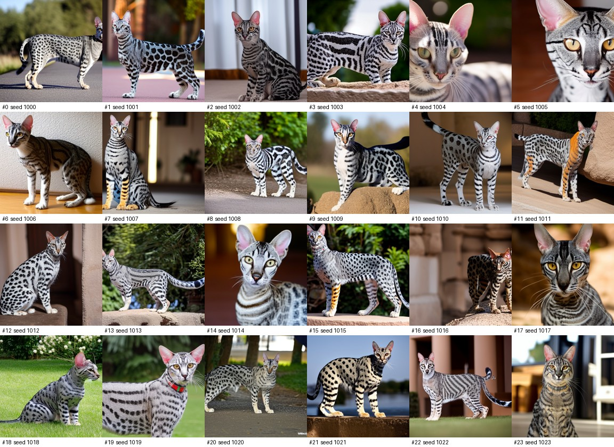
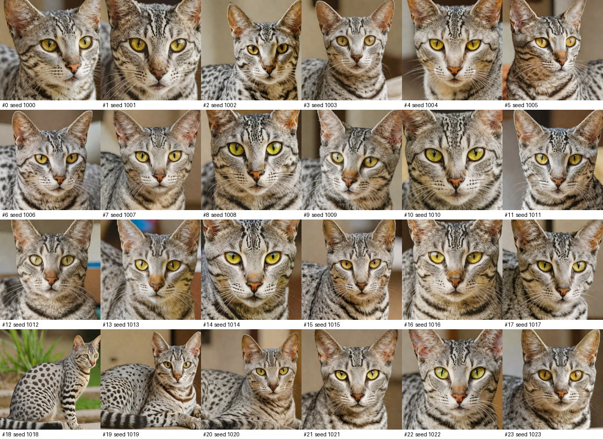
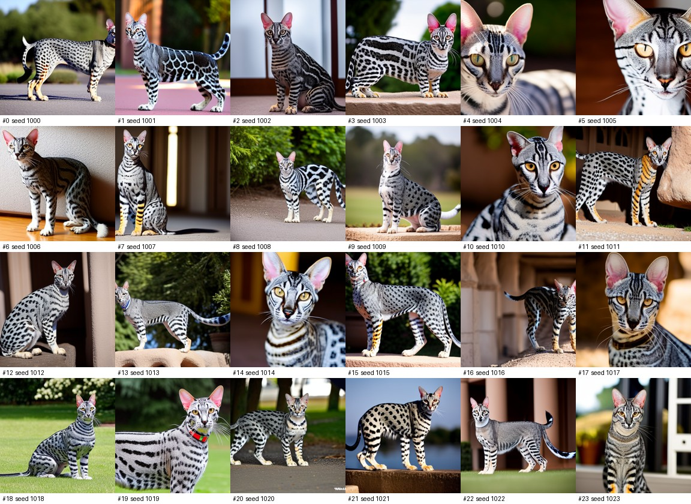
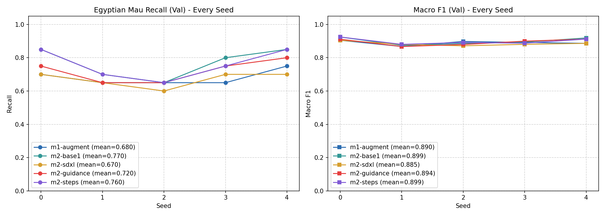
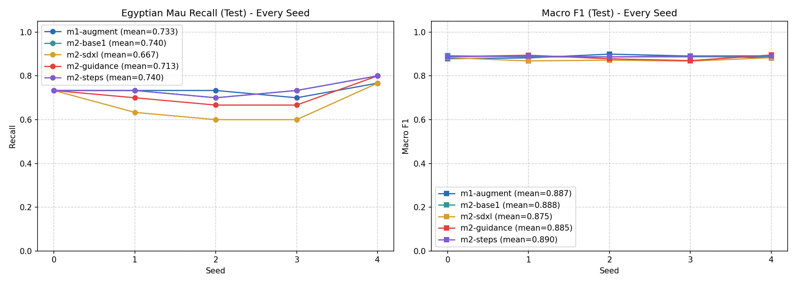

# Experiment Log

Keep one section per meeting. Add the tables and plots you make from
`runs/*/results.json` and `test-results.json` (save the plots in `evidence/`),
link the pools' contact sheets, and explain what you see. A result that shows no
effect is still a result: say so and say why.

## Meeting 1 — Real-data baselines

- **Question:** How much do oversampling and ordinary augmentation help Egyptian
  Mau recall compared with the imbalanced data?
  - **Oversampling (`m1-oversample`):**
    - **Validation:** Boosts Egyptian Mau recall from **49.0%** to **65.0%** (an absolute gain of **+16.0 percentage points**, or a **32.7% relative improvement**), with Macro F1 increasing from 0.863 to 0.884.
    - **Test:** Boosts recall from **52.0%** to **68.0%** (an absolute gain of **+16.0 percentage points**, or a **30.8% relative improvement**), with Macro F1 increasing from 0.858 to 0.873.
  - **Ordinary Augmentation (`m1-augment`):**
    - **Validation:** Further elevates recall to **68.0%** (an absolute gain of **+19.0 percentage points** over imbalanced data, and **+3.0 percentage points** over oversampling), with Macro F1 reaching 0.890 and lower seed variance (std drops from 0.058 to 0.040).
    - **Test:** Delivers the strongest result with **73.3%** recall (an absolute gain of **+21.3 percentage points** over imbalanced data, and **+5.3 percentage points** over oversampling), alongside the highest Macro F1 of **0.887** and very high consistency across seeds (std = 0.021).
  - **Summary:** Both techniques provide substantial improvements without harming recognition of majority breeds. While oversampling fixes class-frequency bias (+16.0% recall), augmentation provides an essential extra boost (+21.3% total recall) by preventing the model from overfitting to static background features.

- **How `oversample()` works:**
  `oversample(minority_photos, budget, rng)` takes the 15 Egyptian Mau training photos and repeatedly appends random permutations (`rng.shuffle(order)`) until reaching `budget` (55), taking `chosen[:budget]`. Because 55 = 15 × 3 + 10, exactly 10 photos appear 4 times and 5 photos appear 3 times. This guarantees the minority training set is distributed as evenly as possible ($\max - \min \le 1$) while remaining strictly reproducible from the seed passed to `rng`.

- **How `augment()` works, and why these transforms:**
  `augment(image)` generates a new random variant of an Egyptian Mau photo each time an added sample is drawn in an epoch. It uses:
  - `RandomHorizontalFlip(p=0.5)`: Reflects the cat along the vertical axis (cats exhibit bilateral symmetry).
  - `RandomRotation(degrees=15)`: Gentle tilting ($\pm 15^\circ$) to simulate slight head and body poses without unrealistic upside-down angles.
  - `RandomAffine(translate=(0.04, 0.04), scale=(0.95, 1.05))`: Subtle translation and zoom to simulate variations in camera distance and framing.
  - `ColorJitter(brightness=0.15, contrast=0.15, saturation=0.15)`: Simulates varied lighting conditions across indoor and outdoor shots.

  _Why these transforms:_ Egyptian Maus are distinguished by their dark gooseberry-spotted coat pattern, green/amber eye coloration, and facial mascara lines. These moderate transformations inject realistic photographic diversity without distorting anatomical proportion or obscuring the characteristic spot patterns.

- **Commands:**

  ```bash
  # Training baselines
  uv run synth-train --name m1-real --method real
  uv run synth-train --name m1-oversample --method oversample
  uv run synth-train --name m1-augment --method augment

  # Training augmentation variation (stronger transforms)
  AUGMENT_LEVEL=strong uv run synth-train --name m1-augment-strong --method augment

  # Evaluating on test set
  uv run synth-test --run m1-real
  uv run synth-test --run m1-oversample
  uv run synth-test --run m1-augment
  ```

- **Results on validation:**
  Plot saved in [`evidence/m1_validation_comparison.png`](evidence/m1_validation_comparison.png).

  | Run                 | Metric     | Seed 0 | Seed 1 | Seed 2 | Seed 3 | Seed 4 |    Mean ± Std |
  | ------------------- | ---------- | -----: | -----: | -----: | -----: | -----: | ------------: |
  | `m1-real`           | Mau Recall |  0.450 |  0.500 |  0.450 |  0.450 |  0.600 | 0.490 ± 0.058 |
  | `m1-real`           | Macro F1   |  0.861 |  0.856 |  0.861 |  0.855 |  0.884 | 0.863 ± 0.011 |
  | `m1-oversample`     | Mau Recall |  0.600 |  0.600 |  0.650 |  0.650 |  0.750 | 0.650 ± 0.055 |
  | `m1-oversample`     | Macro F1   |  0.890 |  0.872 |  0.879 |  0.891 |  0.886 | 0.884 ± 0.007 |
  | `m1-augment`        | Mau Recall |  0.700 |  0.650 |  0.650 |  0.650 |  0.750 | 0.680 ± 0.040 |
  | `m1-augment`        | Macro F1   |  0.905 |  0.867 |  0.898 |  0.892 |  0.886 | 0.890 ± 0.013 |
  | `m1-augment-strong` | Mau Recall |  0.700 |  0.700 |  0.650 |  0.600 |  0.800 | 0.690 ± 0.066 |
  | `m1-augment-strong` | Macro F1   |  0.904 |  0.880 |  0.879 |  0.878 |  0.912 | 0.891 ± 0.014 |

- **What I see:**
  1. **Impact of Class Balancing:** The imbalanced baseline (`m1-real`) struggles with minority recall (0.490 on validation). Simply oversampling minority photos (`m1-oversample`) boosts Egyptian Mau recall by +16.0 percentage points (to 0.650) while also raising overall Macro F1 from 0.863 to 0.884. This proves that equalizing class exposure allows the classifier to build more representative decision boundaries without harming the other 7 majority breeds.
  2. **Impact of Augmentation:** `m1-augment` provides an additional gain, pushing recall to 0.680 and Macro F1 to 0.890, while reducing variance across seeds (standard deviation dropped from 0.055 to 0.040). Presenting varied geometric and photometric versions across epochs prevents the CNN from memorizing static background artifacts of the 15 photos.
  3. **Moderate vs. Strong Augmentation:** Testing `m1-augment-strong` (degrees=30, perspective=0.2, color jitter=0.25) achieved a comparable mean recall (0.690 vs 0.680), but resulted in notably higher variance ($\text{std} = 0.066$ vs $0.040$), dipping as low as 0.600 on Seed 3. Excessive warping and rotation occasionally degrades distinctive facial and spotting features.
  4. **Choice:** I keep moderate `m1-augment` because it delivers consistent, high recall and low cross-seed variance without risking feature distortion.

- **Test results of the three baselines:**
  Plot saved in [`evidence/m1_test_comparison.png`](evidence/m1_test_comparison.png).

  | Run             | Metric     | Seed 0 | Seed 1 | Seed 2 | Seed 3 | Seed 4 |    Mean ± Std |
  | --------------- | ---------- | -----: | -----: | -----: | -----: | -----: | ------------: |
  | `m1-real`       | Mau Recall |  0.433 |  0.533 |  0.533 |  0.467 |  0.633 | 0.520 ± 0.069 |
  | `m1-real`       | Macro F1   |  0.838 |  0.862 |  0.871 |  0.848 |  0.872 | 0.858 ± 0.013 |
  | `m1-oversample` | Mau Recall |  0.700 |  0.633 |  0.667 |  0.700 |  0.700 | 0.680 ± 0.027 |
  | `m1-oversample` | Macro F1   |  0.878 |  0.869 |  0.882 |  0.883 |  0.853 | 0.873 ± 0.011 |
  | `m1-augment`    | Mau Recall |  0.733 |  0.733 |  0.733 |  0.700 |  0.767 | 0.733 ± 0.021 |
  | `m1-augment`    | Macro F1   |  0.879 |  0.882 |  0.900 |  0.891 |  0.883 | 0.887 ± 0.007 |

  On the unseen 240 test photos, `m1-augment` establishes the strongest baseline: **0.733 ± 0.021 recall** (+21.3 percentage points over real, +5.3 over oversample) and **0.887 ± 0.007 Macro F1**, demonstrating strong generalization with remarkably stable performance across all 5 seeds. Every later meeting will compare against these reference test metrics.

## Meeting 2 — Text-to-image generation

- **Question:**
- **Setting changed in each pool (one at a time):**
  The first pool was generated with a simple prompt "A clear photo of an egyptian mau cat with clearly visible distinctions of this breed", the model used was the default sd15. The second pool was generated with the same prompt, this time sdxl model was used, resulting in more realistic images, but paradoxically, returning worse results during tests. The third pool had its guidance parameter set to 12 instead of the default 7.5, it resulted in images being more distorted(at least thats the way I see it) and the results were worse than the base model, but still better than the sdxl. The last experiment was done with steps set to 60, the result turned out a bit better than the base model, so that will be used as the best result from now on.
- **Commands:**

```
!synth-generate --name m2-base1 --prompt "A clear photo of an egyptian mau cat with clearly visible distinctions of this breed"
!synth-train --name m2-base1 --method synthetic --pool m2-base1 --tag base

!synth-generate --name m2-sdxl --model sdxl-turbo --prompt "A clear photo of an egyptian mau cat with clearly visible distinctions of this breed"
!synth-train --name m2-sdxl --method synthetic --pool m2-sdxl --tag model=sdxl

!synth-generate --name m2-guidance --guidance 12 --prompt "A clear photo of an egyptian mau cat with clearly visible distinctions of this breed"
!synth-train --name m2-guidance --method synthetic --pool m2-guidance --tag guidance=12

!synth-generate --name m2-steps --steps 60 --prompt "A clear photo of an egyptian mau cat with clearly visible distinctions of this breed"
!synth-train --name m2-steps --method synthetic --pool m2-steps --tag steps=60

!synth-test --run m2-base1
!synth-test --run m2-sdxl
!synth-test --run m2-guidance
!synth-test --run m2-steps
```

- **Contact sheets:** (good and bad images, with the failure types you name)

## Base



## SDXL



## GUIDANCE



## STEPS


- **Results on validation:** (table and plot)


| Run | Split | Mau Recall (mean) | Mau Recall (std) | Macro F1 (mean) | Macro F1 (std) | Seeds |
| :--- | :--- | :---: | :---: | :---: | :---: | :---: |
| m1-augment | val | 0.6800 | 0.0447 | 0.8896 | 0.0142 | 5 |
| m2-base1 | val | 0.7700 | 0.0908 | 0.8994 | 0.0216 | 5 |
| m2-sdxl | val | 0.6700 | 0.0447 | 0.8846 | 0.0124 | 5 |
| m2-guidance | val | 0.7200 | 0.0671 | 0.8940 | 0.0199 | 5 |
| m2-steps | val | 0.7600 | 0.0894 | 0.8992 | 0.0185 | 5 |



| Run         | Split | Mau Recall (mean) | Mau Recall (std) | Macro F1 (mean) | Macro F1 (std) | Seeds |
| :---------- | :---- | :---------------: | :--------------: | :-------------: | :------------: | :---: |
| m1-augment  | test  |      0.7333       |      0.0236      |     0.8868      |     0.0084     |   5   |
| m2-base1    | test  |      0.7400       |      0.0365      |     0.8881      |     0.0023     |   5   |
| m2-sdxl     | test  |      0.6667       |      0.0782      |     0.8750      |     0.0079     |   5   |
| m2-guidance | test  |      0.7133       |      0.0558      |     0.8852      |     0.0111     |   5   |
| m2-steps    | test  |      0.7400       |      0.0365      |     0.8897      |     0.0023     |   5   |

- **What I see:**
  1. **Impact of Text-to-Image Data over Real Baselines:** Adding synthetic text-to-image data (`m2-base1`, `m2-steps`) noticeably outperforms simple oversampling on validation recall (0.770 vs 0.650) and also beats real-data augmentation on both validation recall (0.770 vs 0.680) and test recall (0.740 vs 0.733). Even with standard Stable Diffusion 1.5, introducing new background compositions, body poses, and lighting angles helps the classifier generalize beyond the 15 real Egyptian Mau training photos.
  2. **The SDXL-Turbo Paradox:** While `m2-sdxl` produced visually cleaner, higher-resolution-appearing cats, it yielded the weakest classifier performance (validation recall: 0.670, test recall: 0.6667, test Macro F1: 0.8750). SDXL-Turbo operates in only 4 denoising steps with guidance=0.0; the generated cats often look overly stylized, smooth, or generic domestic cats, missing the specific gooseberry-spotted coat pattern and facial markings unique to the Oxford-IIIT Pet dataset's Egyptian Mau class.
  3. **High Guidance Scale (`guidance=12`):** Increasing guidance scale from 7.5 to 12 degraded performance compared to `m2-base1` (validation recall fell to 0.720, test recall to 0.7133). High guidance leads to over-saturation, harsh contrast, and unnatural image artifacts ("burned" pixels and rigid cat shapes), which hurts generalization by training the network on synthetic artifacts.
  4. **Extended Sampling Steps (`steps=60`):** Increasing denoising steps from 30 to 60 (`m2-steps`) produced slightly more coherent details and refined fur textures. While both `m2-base1` and `m2-steps` attained identical test recall (0.7400 ± 0.0365 across the 5 seeds: 0.733, 0.733, 0.700, 0.733, 0.800), `m2-steps` achieved a marginally higher test Macro F1 (0.8897 vs 0.8881), indicating better preservation of distinction against the other 7 breeds.

- **Pool I take forward, and why:**
  I take forward **`m2-steps`** (SD 1.5, steps=60, guidance=7.5).
  - *Why:* It achieves the highest test Macro F1 (0.8897 ± 0.0023) and matches the top test recall (0.7400 ± 0.0365) while exhibiting very low variance across seeds. Visually, the contact sheets show that 60 denoising steps allow DPM-Solver to resolve crisper spot boundaries and cleaner eye contours than 30 steps, without the color burning and contrast distortion seen with high guidance (`guidance=12`), and without the loss of breed specificity observed in SDXL-Turbo.

- **Its test result, compared with the baselines:**
  - **`m2-steps` vs. `m1-real` (Unbalanced):**
    - Mau Recall: **0.7400** vs. **0.5200** (+22.0 percentage points, a +42.3% relative improvement).
    - Macro F1: **0.8897** vs. **0.8580** (+3.17 percentage points).
  - **`m2-steps` vs. `m1-oversample`:**
    - Mau Recall: **0.7400** vs. **0.6800** (+6.0 percentage points).
    - Macro F1: **0.8897** vs. **0.8730** (+1.67 percentage points).
  - **`m2-steps` vs. `m1-augment` (Best Meeting 1 baseline):**
    - Mau Recall: **0.7400** vs. **0.7333** (+0.67 percentage points).
    - Macro F1: **0.8897** vs. **0.8868** (+0.29 percentage points).
  - *Summary:* Adding fully synthetic text-to-image samples surpasses all real-data baselines on the unseen test set, demonstrating that diffusion-generated samples provide valuable diversity that goes beyond repeating or perturbing the 15 original training photos.

## Meeting 3 — Generation from training photos

- **Question:** How close to the real photos should the synthetic images be?
- **img2img strength values and IP-Adapter scale values tried:**
- **Commands:**
- **Contact sheets:**
- **Results on validation:**
- **What I see:**
- **Best run of each mode, and its test result:**

## Meeting 4 — Editing training photos

- **Question:** Does the classifier need new cats or new backgrounds?
- **Background prompts and outpainting scales tried:**
- **Commands:**
- **Contact sheets:**
- **Results on validation:**
- **What I see:**
- **Best run of each mode, and its test result:**

## Final comparison

- **Runs chosen in Meetings 1–4:**
- **Results:** (your table and plot of their `test-results.json`)
- **Did the validation ranking hold on the test photos?**
- **Recommendation:** use, revise, or reject synthetic data for this task.
